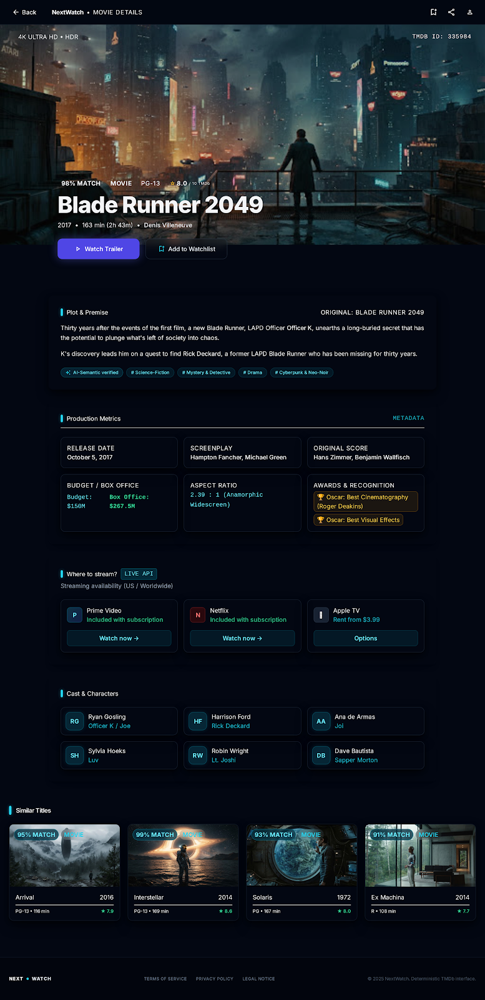

# NuxtWatch

NuxtWatch aims to help people find movies and TV shows by describing what they want in their own words. They can start with a simple request and refine it in later messages without repeating what they already said.

## How search should work

1. The LLM interprets each message and proposes structured changes to the search criteria or flags an ambiguity. It does not change the search state or make TMDb requests.
2. The application validates the proposal and combines it with the current criteria in one shared search object. This object describes what the user wants, not which TMDb endpoints or parameters to use.
3. The application asks a focused question only when an ambiguity or missing detail prevents it from carrying out the request as stated. The current search remains unchanged while clarification is pending. If a criterion is unsupported, the application explains the limitation rather than silently dropping it.
4. The application maps the validated criteria to verified TMDb calls, runs them server-side, and displays the matching titles. User feedback comes from translatable templates.

For example, “Find The Matrix” is enough to search without asking for a year or media type. “I mean the 1999 movie” adds those criteria while keeping the title. Multiple matching titles are a valid result, not a reason to ask for clarification before searching.

## Starting point

This repository starts from the NextWatch `v0.0.1` Spike source snapshot (`e835d5a7813859ef708c1826963ede62601874a4`), without the original Git history. The search flow above describes the project goal, not what is already implemented.

## Getting started

Copy `.env.example` to `.env` and add your own TMDb credentials. TMDb requests must remain server-side.

```bash
pnpm install
pnpm dev
```

## Checks

```bash
pnpm test
pnpm test:coverage
pnpm lint
pnpm typecheck
```

See [AGENTS.md](AGENTS.md) for the working agreement, [TMDb search examples](docs/tmdb-search-examples.md) for verified requests, and [docs/](docs/) for further documentation.



