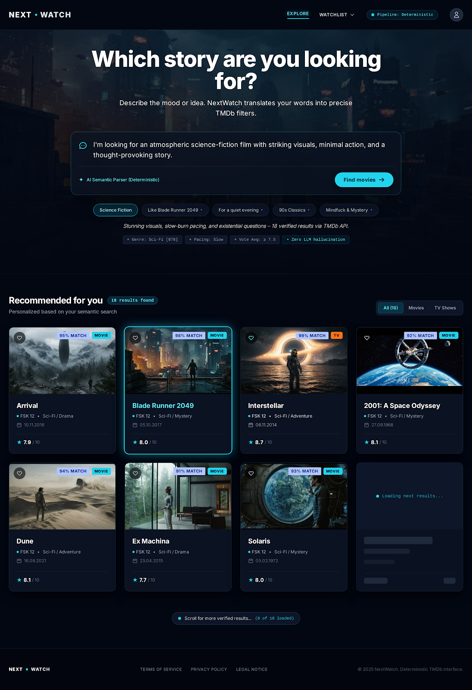

# NuxtWatch

NuxtWatch helps people find movies and TV shows by describing what they want in their own words. The LLM proposes structured criteria changes; the application validates them, decides whether clarification is required, and executes verified TMDb requests server-side.

## Implemented search scope

The shared title-search flow supports a title, movie/TV scope, and an optional single year through `POST /api/search`.

- Title with `all` and no year uses Multi search. Explicit movie or TV scope uses the corresponding endpoint.
- Title with a year and `all`, including explicitly requested movies and series, requires a bound movie/TV selection. Title and year are preserved. Lists are not merged and the year is not silently removed.
- Confirmed criteria remain unless explicitly changed. Validated criteria may already be stored while clarification is pending; clarification itself never starts a title search.
- `submit` opens a new request and may search immediately when executable. `clarify` only resolves the bound question. After clarification, `execute` runs the confirmed revision without another LLM interpretation. `reset` starts a new session context.
- Search cards exclude people. Page results and total counts are separate; an unavailable total is `null`, not zero.

The terminal client is an alternative interface to the same HTTP contract:

```bash
node scripts/search.mjs http://localhost:3000
```

## Getting started

Copy `.env.example` to `.env` and configure TMDb and the local model integration. Provider credentials remain server-side.

```bash
pnpm install
pnpm dev
```

## Checks and current status

```bash
pnpm test
pnpm test:coverage
pnpm lint
pnpm typecheck
```

On 22 November 2026, the user confirmed passing tests, lint and typecheck, plus coverage above 80%, on the working state including `d6e071c`. The local live HTTP audit reported eight passed, zero failed and zero blocked cases. This closes the agreed shared-search/title slice, not production readiness, exhaustive model reliability, or all race/failure scenarios. Evidence, attribution, structure and limits are recorded in the [search concept](docs/search-architecture-concept.md). The locally supplied audit script and raw reports are not committed.

## Documentation and origin

See [AGENTS.md](AGENTS.md), the [search concept](docs/search-architecture-concept.md), and [verified TMDb requests](docs/tmdb-search-examples.md). The concept is the permanent reference for search architecture and its verification status; historical task details remain accessible through its fixed Git link.

The repository originated from the NextWatch `v0.0.1` Spike source snapshot (`e835d5a7813859ef708c1826963ede62601874a4`), without its original Git history. Broader search criteria and the web wizard remain separate future work.



