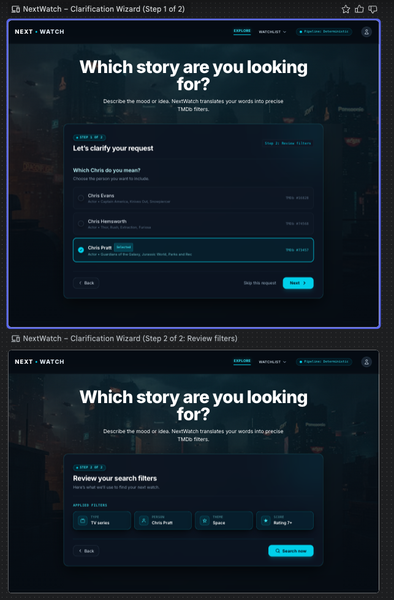

# Clarification Wizard

Dieses Dokument spezifiziert den UI-Ablauf. Zuständigkeiten, Suchwegprüfung und Auftragsbindung stehen im [Sucharchitektur-Konzept](sucharchitektur-konzept.md).

## Einstieg

- Ohne Klärungsbedarf startet „Jetzt suchen“ am Suchschlitz eine ausführbare Suche direkt. Es gibt keine vorgeschaltete Übersicht. Ist die Suche nicht ausführbar und hilft keine Rückfrage, erklärt die Anwendung den Grund.
- Bei Klärungsbedarf öffnet sich der Wizard als Overlay. Die bisher ausgeführte Suche bleibt bis zum ausdrücklichen Start einer neuen Suche unverändert.

## Ablauf im Overlay

1. **Frage:** Pro Seite erscheint eine von der Anwendung bestimmte Frage mit Vorauswahl. Die aktive Option ist erkennbar; technische IDs werden nicht angezeigt. „Übernehmen“ bestätigt die aktuelle Auswahl, auch bei der einzigen oder letzten Frage. Passt keine Option, kann der Nutzer die Eingabe präzisieren. Notwendige Kriterien werden nicht übersprungen oder stillschweigend weggelassen.
2. **Kriterienübersicht:** Nach jeder erfolgreich beantworteten Frage zeigt eine eigene Seite alle bestätigten Kriterien als Pills. Neue oder geänderte Pills werden hervorgehoben. Offene oder nicht unterstützte Kriterien werden nicht als bestätigt angezeigt. Unabhängig geklärte Kriterien können bereits während der Klärung als Pills sichtbar sein.
3. **Nächster Schritt:** Ist noch eine notwendige Frage offen, führt „Weiter zur nächsten Frage“ zur nächsten Frageseite. Erst wenn keine notwendige Frage mehr offen und der gezeigte Stand ausführbar ist, bietet die Übersicht „Suche starten“ an. Ist der Stand nicht ausführbar und hilft keine weitere Frage, erklärt die Anwendung den Grund. Solange eine notwendige Frage offen ist, kann der Wizard weder auf der Frageseite noch in der Übersicht geschlossen oder abgebrochen werden.
4. **Suchstart:** Weder die Auswahl noch „Übernehmen“ noch das Öffnen der Übersicht startet eine Suche. „Suche starten“ sendet den angezeigten Kriterienstand zur erneuten serverseitigen Prüfung und Ausführung. Die ausgeführten Kriterien müssen den angezeigten entsprechen. Nach akzeptiertem Start schließt sich das Overlay; die Suchansicht zeigt bestätigte Kriterien und den bestehenden Ergebnisbereich. Technische Fehler bleiben von leeren Ergebnissen unterscheidbar.

## Zustände und Bedienung

- Die UI entscheidet nicht selbst über Suchweg oder Ausführbarkeit. Vorgegebene Antworten werden per Optionskennung an die Anwendung übermittelt und benötigen keinen erneuten LLM-Aufruf. Eine freie Präzisierung kann neu interpretiert werden.
- Veraltete Antworten und Startversuche dürfen keine neueren Kriterien überschreiben, das Overlay nicht erneut öffnen und keine zweite Suche auslösen.
- Texte sind lokalisierbar. Auswahl, Buttons und Wechsel zwischen Frage und Übersicht müssen per Tastatur bedienbar sein; der Fokus wechselt nachvollziehbar. Ergebnisdarstellung und Detailseiten werden nicht neu gestaltet.

## Abnahme

- Ausführbare Eingabe ohne Rückfrage startet direkt am Suchschlitz.
- Ein- und mehrstufige Klärung zeigen nach jeder bestätigten Antwort die vollständige Pill-Übersicht. Unveränderte Vorauswahl und abweichende Auswahl werden korrekt übernommen.
- Bei offener Pflichtfrage ist nur das Weiterführen oder Präzisieren der Klärung möglich, nicht der Suchstart oder Abbruch. Ohne ausführbaren Weg erscheint ein begründeter Hinweis.
- Der ausdrückliche Start nutzt genau die angezeigten Kriterien und löst bei Wiederholung keinen zweiten Aufruf aus. Veraltete Antworten und Starts werden abgefangen.
- Tastaturbedienung und Fokuswechsel funktionieren; technische Fehler und leere Ergebnisse bleiben unterscheidbar.

