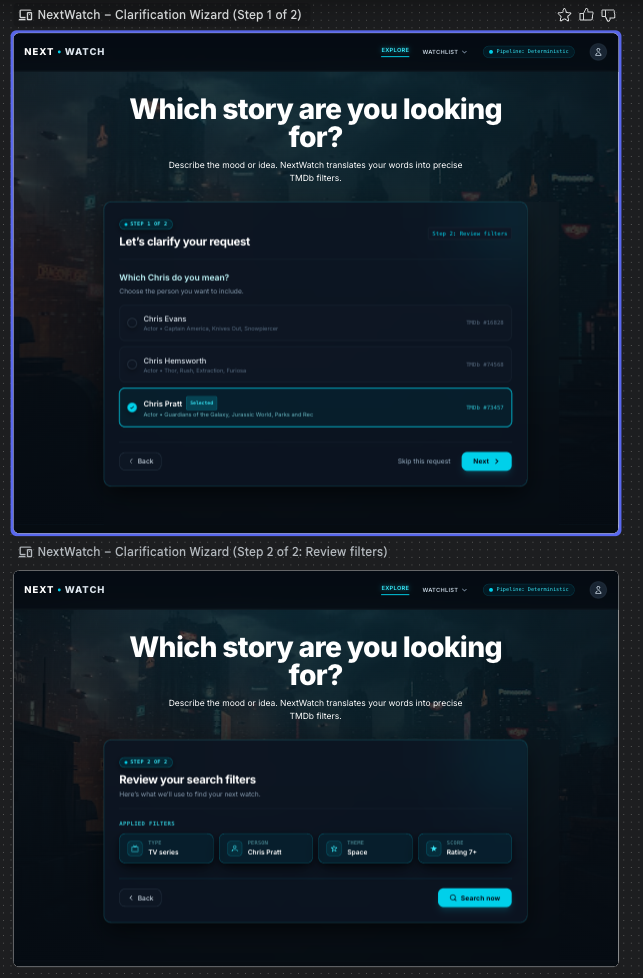

# Clarification Wizard – Terminal and Future Web UI

As of 21 November 2026. Updated reference for NuxtWatch; shared behavior follows the [concept](../search-architecture-concept.md). This is not comprehensive evidence of implementation. The existing filename is retained until a separate rename.

## Shared Flow

- When no clarification is needed, an explicit submit may search directly; do not require prior confirmation merely because multiple results are expected.
- When clarification is needed, the interface displays the bound question and confirmed criteria. Offer only options permitted by the server; a general LLM question initially supports free text only, with no options inferred from its wording.
- Validate a selection against the specific question without using the LLM. Free text entered while a question is open is a bound answer and is interpreted together with the original search request, confirmed criteria, and question history.
- After applying an answer, display the confirmed criteria and the next required question or execution readiness. Answering a question or displaying a summary must not itself trigger a result search.
- Only an explicit execute starts the search after clarification, using the bound server state. Client-side replacement criteria do not bypass the binding.
- An explicitly new submit or reset remains possible and supersedes the previous request. A required open question must neither be skipped nor allow execution with unresolved criteria; however, it must not lock the user into a dialog they cannot leave.
- If no path is executable and no useful clarification question is possible, explain the reason and allow the user to refine the request or start a new one. Independent partial confirmation is a goal, not yet fully implemented.

## Terminal First, Extended as Needed

The terminal is an alternative interface for the same HTTP actions, not a separate parser-testing path. Questions, criteria, and simple selection lists are sufficient initially. Keep `/submit TEXT`, `/reset`, and explicit execute distinct. Do not recreate the entire graphical wizard in advance; add only the interaction needed for each vertical slice.

Present results compactly as a table, text card, or reduced object, for example with title, type, and year. Retain ID plus media type internally for identification. Do not display complete provider objects in the normal view. Distinguish errors, empty result lists, and results; do not present earlier results as the outcome of a new blocked revision.

## Future Graphical Presentation

Use an overlay with one question per page, clearly identifiable selection, and “Apply” for confirmation. After applying an answer, a criteria summary may follow as pills; highlight changed values. “Next” leads to the next question, while “Start search” is available only when the state is executable. A new request and reset remain explicit exits; specify graphical cancellation details separately. Do not introduce a contradictory requirement to finish an unresolved dialog at all costs.

The web UI does not import a server matrix. Stale responses must not reopen an old overlay or overwrite criteria. Localizable text, keyboard operation, and predictable focus remain target requirements. Detail pages require an explicit result selection, even when there is only one result.

## Acceptance

Direct submit without unnecessary questions; single- and multi-step bound clarification; selection and free text; correction without losing criteria; explicit execute; supersession through submit or reset; rejection of stale actions; distinction between technical errors and empty results. Assess graphical focus and pill details only when implementing the web UI.

