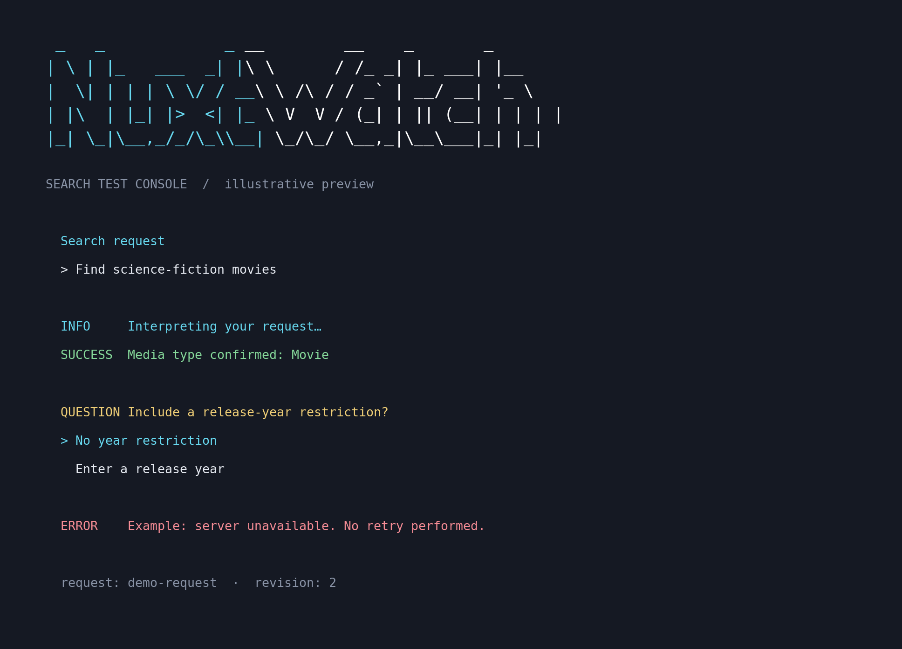

# Interactive CLI for Search and Clarification

Status: Idea only; not implementation approval.

## Goal

Extend the existing CLI into a guided terminal interface for manually testing search requests, LLM interpretation, feedback, clarification dialogs, and search results without a web GUI. The interaction should resemble project starters such as create-vue: text prompts, selection menus, and status indicators instead of memorized slash commands. The tool does not scaffold projects and does not initially need publication as a standalone npm package.

## Existing Foundation

`scripts/search.mjs` is already an interactive HTTP client for `POST /api/search`. It supports new requests, bound free-text and selection answers, explicit execution after applicable clarification, reset, and exit. It displays criteria and server decisions as JSON and search results as a compact table.

The client keeps the session cookie in the running process and sends request, revision, and question bindings. A separately running backend remains necessary. The CLI does not call the LLM directly: configuration, credentials, interpretation, and search execution remain server-side.

## Bounded First Iteration

Extend the existing script rather than introduce a second CLI. A single coherent implementation commit is a reasonable target for this bounded iteration; finalize its scope after inspecting the current code and repository rules.

Proposed scope:

- Add `@clack/prompts` as a development dependency, including the lockfile update; verify a compatible version and the required APIs before implementation.
- Replace the current readline interaction with guided text prompts and selection menus.
- Allow entering search requests and deliberately starting a new request while clarification is pending.
- Support keyboard selection of structured answer options and free-text clarification answers.
- Clearly separate criteria, server feedback, questions, and errors in the output.
- Offer explicit execution of an executable clarified request without imposing a new confirmation requirement on every initial submission.
- Offer understandable reset and exit actions.
- Show a progress indicator during HTTP requests and handle cancellation and errors cleanly.
- Continue displaying results as a compact table with essential fields.
- Add a launch command such as `pnpm search:cli` and document the separate backend requirement.
- Add focused tests for changed client control behavior and run available project checks; explicitly record outcomes and any checks not run.

Use consistent semantic colors for informational messages, successful outcomes, clarification requests, warnings, and errors. Keep secondary metadata visually subdued. Always retain explicit text labels so that meaning does not depend on color alone. Reuse Clack’s built-in styling where sufficient; add a separate color utility only if needed.

`@clack/prompts` is the proposed library candidate, not an installed or finally approved dependency. A custom full-screen terminal interface is unnecessary.

## Architecture and Preserved Rules

```text
Interactive CLI interface
  -> existing search API
    -> shared flow, LLM, matrix, and provider
```

- Keep the backend API, LLM instructions, matrix, and search logic unchanged in the first iteration.
- Do not introduce CLI-owned search interpretation, a readiness matrix, or a separate domain state machine.
- Present currently applicable actions using the existing API contract; local interaction guards do not replace server-side validation.
- Preserve request, revision, and question bindings and existing session behavior.
- Do not add automatic follow-up calls, retries after errors, or automatic search execution.
- When server state is uncertain or bindings are expired or conflicting, do not present execution readiness as still valid.
- Local cancellation does not prove that an already-started server operation was cancelled or rolled back.
- Keep credentials and server modules out of the CLI client.

The main effort is not building menus, but preserving existing state, binding, and error guarantees during the interface change.

## First-Iteration Acceptance

- The existing search and clarification functionality is usable without a web GUI or knowledge of slash commands.
- Free text and structured selections map correctly to existing API actions.
- New requests, clarification, execution, and reset retain their existing meaning.
- Progress indicators finish reliably on success, error, and local cancellation.
- Errors cause neither automatic retries nor additional provider calls initiated by the client.
- Existing criteria and result information remains visible.
- Changes remain limited to the CLI, required dependencies, launch command, documentation, and focused tests.

## Outside the First Iteration

- Saved scenarios and conversation exports.
- Batch testing and automated expected-versus-actual comparisons.
- A dedicated test-run rating system.
- Extensive diagnostic or trace views requiring new backend contracts.
- Keyword experiment commands or Discover extensions.
- Result pagination, a second session subsystem, or a new search architecture.
- A full-screen TUI or publication as a standalone npm tool.

These extensions may be described and approved separately when a concrete need arises. This idea document does not authorize implementation or additional product features.


