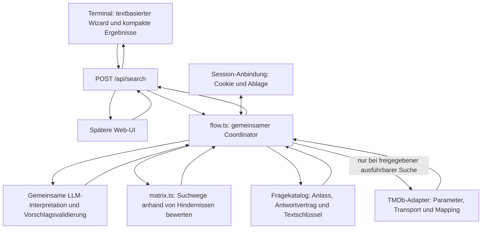

# NuxtWatch – Sucharchitektur

Stand: 21. November 2026. Verbindliches Zielbild nach dem Titel-/Klärungsdurchstich, kein vollständiger Implementierungsnachweis. [Arbeitsstand](tasks/search-architecture/README.md), [Dateien und Zuständigkeiten](tasks/search-architecture/zielstruktur.md).

## Grundlage und Arbeitsweise

Die Anwendung führt natürliche Sprache über bestätigte Kriterien zur ausführbaren Suche. Grundlage sind die [TMDb-Analyse](tmdb-api-analysis.md) und die [geprüften Suchbeispiele](tmdb-search-examples.md). API-Fähigkeit, Produktentscheidung und implementiertes Verhalten sind getrennt zu dokumentieren. Titel ist der erste Suchweg, nicht die Grundlage für getrennte Parser je Suchstrecke.

Wir arbeiten suchwegweise: Regeln und API-Belege prüfen, einen kleinen vertikalen Durchstich umsetzen, im Terminal erproben, Lücken feststellen und Findings in verbindliche Regeln übernehmen. Danach folgt der nächste Suchweg. Keine vollständige Matrix auf Vorrat, keine generische Regel-Engine, zweite Routing-Matrix oder vorsorgliche Datenbank.

## Architektur und Verantwortlichkeiten

- Das LLM interpretiert neue Suchwünsche und gebundene Antworten. Es schlägt Kriterienänderungen oder Klärungsbedarf vor, übernimmt keinen Zustand, erfindet keine IDs und wählt keinen Endpunkt. Systemauftrag und Nutzerdaten bleiben getrennt; Eingabe und strukturierter Vorschlag bleiben JSON.
- Ein gemeinsamer Coordinator in `flow.ts` prüft Aktualität, validiert und übernimmt Änderungen, plant den nächsten Schritt und koordiniert Ausführung und Ergebnis. Keine konkurrierenden Coordinator-/Workflow-/Submit-Schichten.
- `matrix.ts` hält Suchmöglichkeiten und Hindernisbewertung zusammen. Jeder fachlich passende Weg wird gegen denselben Kriterienstand bewertet; die Reihenfolge verändert das Ergebnis nicht. Regeln werden nicht in Prompt, Matrix und Adapter mehrfach implementiert. Fähigkeiten dürfen im Prompt erläutert werden; verbindlich prüft die Anwendung.
- Adapter übersetzen einen ausgewählten Weg in TMDb-Aufrufe und normalisieren Antworten. Sie verändern weder Session noch Suchabsicht. Kandidatenauflösungen sind keine Treffersuche.
- HTTP behandelt Transport und Grenzvalidierung. Session-Anbindung behandelt Zuordnung und Ablage. Oberflächen stellen serverseitige Fragen und Ergebnisse dar, importieren keine Servermatrix und bestimmen keine eigenen Fachregeln.

## Kriterienmatrix: Hindernisse statt Kombinationskatalog

Ein gemeinsames Kriterienobjekt beschreibt den Suchwunsch, nicht den Endpunkt. Kein globaler Titelzwang. Aktuell sind Titel, Medientyp und Einzeljahr vorgesehen; weitere Kriterien werden erst mit ihrem Durchstich ergänzt. Unbekannte oder nicht abgedeckte Kriterien dürfen nicht stillschweigend entfallen. Eine leere Hindernisliste bedeutet nur dann ausführbar, wenn der Weg alle bestätigten Kriterien und den gemeinten Suchumfang berücksichtigt.

### Fähigkeiten der aktuellen Titelwege

| Eigenschaft | Multi | Movie | TV |
| --- | --- | --- | --- |
| Titelbegriff erforderlich | Ja | Ja | Ja |
| Durchsuchte Inhalte | Filme, Serien, Personen | Filme, keine Serien | Serien, keine Filme |
| Einzeljahr als Suchparameter | Nein | `primary_release_year` | `first_air_date_year` |

Multi-Personentreffer werden nicht zu Titelkarten. Medientyp nicht festgelegt bedeutet Filme und Serien; intern kann dies weiterhin `all` heißen. `include_adult=true`, Locale und Pagination sind Ausführungsoptionen, keine zusätzlich erforderlichen Nutzerkriterien. Keine Adult-basierte Ausfilterung von Film-/Serientreffern.

### Ausschlussregeln für die aktuell gewählten direkten Wege

| Bedingung | Hindernis | Konsequenz |
| --- | --- | --- |
| Titel fehlt oder ist leer | Alle Titelwege benötigen einen Titel | Nur bei gemeinter Titelstrecke Titel klären; andere Suchabsichten nicht zur Titelsuche umdeuten |
| Medientyp nicht festgelegt | Movie allein durchsucht keine Serien; TV allein keine Filme | Beide Einzelwege decken den uneingeschränkten Umfang nicht ab; Multi bleibt ohne Jahresfilter möglich |
| Nur Filme gewünscht | TV durchsucht keine Filme; Multi würde zusätzliche Medientypfilterung benötigen | Direkten Movie-Weg verwenden |
| Nur Serien gewünscht | Movie durchsucht keine Serien; Multi würde zusätzliche Medientypfilterung benötigen | Direkten TV-Weg verwenden |
| Einzeljahr vorhanden | Multi hat keinen Jahresparameter | Jahr niemals weglassen; typspezifischen Weg prüfen |
| Bestätigtes Kriterium nicht abgedeckt | Suchwunsch nicht vollständig ausführbar | Klären oder begründet als nicht unterstützt melden |

Folge für Titel plus Jahr ohne Medientyp: Medientyp klären. Dies ist unsere aktuelle Produktentscheidung gegen Zusammenführung zweier Ergebnislisten und gegen eigene Jahres-Nachfilterung, keine grundsätzliche Unmöglichkeit der API. Titel allein ist ohne Medientypfrage über Multi ausführbar. Discover ist kein Ersatz für freien Titelabgleich. Weitere Suchstrecken erhalten ihre Regeln erst anhand ihrer belegten Fähigkeiten.

Mehrere technisch gleichwertige Wege sind keine Nutzerfrage. Unterschiedliche fachliche Bedeutungen werden geklärt, statt den bequemsten Endpunkt zu bevorzugen. Jahresbereiche sind noch nicht implementiert; genaue Datumsangaben werden nicht ungefragt auf Einzeljahre verkürzt.

## Aktionen, Kriterien und Bindungen

- `submit`: neuer Auftrag auf Basis bestätigter Serverkriterien; ersetzt den bisherigen Auftrag. Ohne Klärungsbedarf darf die ausdrücklich beauftragte Suche direkt starten. Der Client liefert keinen Ersatz für den Serverstand.
- `clarify`: Antwort auf konkrete offene Frage prüfen, Änderungen übernehmen und erneut bewerten. Startet niemals eine Treffersuche.
- `execute`: gebundenen bestätigten Stand erneut prüfen und ausdrücklich ausführen; keine erneute Sprachinterpretation.
- `reset`: neuer Suchkontext ohne bisherige Kriterien.

`submit` und `execute` nutzen dieselbe Ausführung und Reservierung. `requestId`, `revision` und `questionId` binden Antworten an Auftrag, Kriterienstand und konkrete Frage. Geprüfte Auswahlen benötigen kein LLM; gebundener Freitext nutzt denselben Parser wie Submit. Veraltete Antworten und verspätete Ergebnisse dürfen keinen neueren Zustand überschreiben oder alte Fragen wieder öffnen. Externe Aufrufe müssen dafür nicht technisch abbrechbar sein.

Der Server reserviert die Ausführung vor dem Provideraufruf. Derselbe gebundene Stand startet nicht parallel oder nach Erfolg erneut; technischer Fehler erlaubt einen ausdrücklichen neuen Versuch. Clientseitige Submit-Idempotenz und erneute Ergebnisauslieferung bei Wiederholung sind noch gesondert festzulegen, nicht als vorhanden zugesichert. Prozesslokale Ablage garantiert weder Neustartfestigkeit noch instanzübergreifende Bindung.

Unabhängig geklärte Kriterien sollen bereits während offener Klärung bestätigt werden können; gekoppelte Änderungen werden gemeinsam geprüft. Diese Teilübernahme ist im bisherigen Vertrag noch nicht vollständig umgesetzt. Eindeutige Korrekturen ersetzen den bisherigen Wert, andere bestätigte Kriterien bleiben erhalten.

## Wizard, Terminal und Texte

Das Terminal ersetzt während der Entwicklung die Web-UI und kann den Wizard textbasiert abbilden. Es wird explorativ nach Bedarf erweitert, nicht vorab vollständig ausgebaut. Es nutzt dieselben HTTP-Aktionen und Verträge. Bei offener Frage ist normaler Freitext eine gebundene Antwort; sonst ein Submit. `/submit TEXT` eröffnet ausdrücklich einen neuen Auftrag, `/reset` einen neuen Kontext. Nach Klärung ist ausdrückliches Execute erforderlich.

Für gebundene Interpretation erhält das LLM ursprünglichen Suchwunsch, bestätigte Kriterien, bisherigen auftragsbezogenen Frage-/Antwortverlauf, aktuelle Frage und Antwort. Kein allgemeiner Chatverlauf auf Vorrat.

Ergebnisse werden kompakt als Tabelle/Karte oder reduziertes Objekt dargestellt, zunächst mit den nötigen Angaben zum Erkennen und Unterscheiden, nicht mit vollständigen Providerdaten. ID und Medientyp identifizieren Treffer gemeinsam. Technischer Fehler, erfolgreiche leere Liste und erfolgreiche Liste mit Treffern bleiben unterscheidbar. Vorherige Ergebnisse dürfen nicht als Ergebnis einer neueren, noch blockierten Revision erscheinen. Optionale Eingrenzung nach Ergebnissen ist von zwingender Klärung vor Ausführung getrennt; ihr Lebenszyklus bleibt offen.

Internationalisierung bleibt verbindliches Ziel: Anwendungseigene Fragen, Optionen, Bestätigungen und Hinweise liegen zentral und übersetzbar vor, nicht als verstreute Texte in der Fachlogik. Fachliche Ergebnisse liefern Anlass/Grund und Parameter; der Fragekatalog verbindet sie mit Antwortvertrag und Textschlüsseln. Zunächst genügt eine zentrale Textdatei; Sprachdateien und Vollständigkeitsprüfungen folgen bei Bedarf. Siehe [Textkatalog-Skizze](ideas/translation-catalog.md). Die [Wizard-Skizze](ideas/clarificaton-wizzard-flow.md) ergänzt das spätere grafische Verhalten; bei Konflikten gelten die hier beschlossenen gemeinsamen Abläufe.

## Struktur und Umfang

Verbindliche Namen, Verantwortlichkeiten und Umbauzuordnung stehen ausschließlich in der [Zielstruktur](tasks/search-architecture/zielstruktur.md). Gemeinsame Funktionen und DRY haben Vorrang; keine zusätzliche `title.ts` als bloßer Adapter-Wrapper. Keine Parser pro Suchweg und keine State-Machine-Bibliothek ohne konkreten Bedarf. Personen, Keywords, Genre, Discovery, Similarity und Jahresbereiche werden nacheinander untersucht, nicht vorab implementiert. Zugriffsschutz und Ressourcenlimits sind vor öffentlichem Betrieb zu klären.
