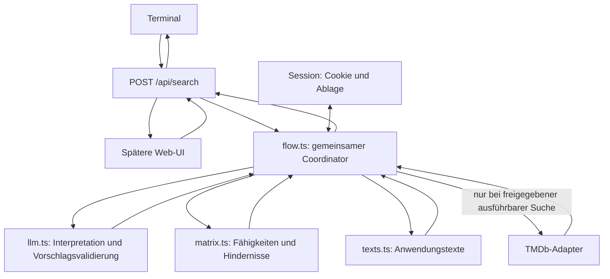

# NuxtWatch – Sucharchitektur

Stand: 22. November 2026. Codebezug: `a806145`. Verbindliches Zielbild, kein vollständiger Implementierungs- oder Abnahmenachweis. [Arbeitsstand](tasks/search-architecture/README.md), [Dateien und Zuständigkeiten](tasks/search-architecture/zielstruktur.md), [Prüfprotokoll](tasks/search-architecture/01-shared-search-matrix.md).

## Grundlage und Arbeitsweise

Die Anwendung führt natürliche Sprache über bestätigte Kriterien zur ausführbaren Suche. Grundlage sind die [TMDb-Analyse](tmdb-api-analysis.md) und die [geprüften Suchbeispiele](tmdb-search-examples.md). API-Fähigkeit, Produktentscheidung und implementiertes Verhalten bleiben getrennt. Titel ist der erste Abnahmefall der gemeinsamen Architektur, nicht die Grundlage getrennter Parser je Suchstrecke.

Suchwegweise arbeiten: API-Belege und Regeln prüfen, kleinen vertikalen Durchstich umsetzen, im Terminal erproben und Findings in gemeinsame Regeln übernehmen. Erst danach nächsten Suchweg auswählen. Keine vollständige Matrix auf Vorrat, generische Regel-Engine, zweite Routing-Matrix oder vorsorgliche Datenbank.

## Architektur und Verantwortlichkeiten

- LLM: neue Wünsche und gebundene Antworten interpretieren, Kriterienänderungen vorschlagen, echte sprachliche Mehrdeutigkeit klären. Keine Zustandsübernahme, erfundenen IDs, Endpunktwahl, Matrixentscheidung oder Treffersuche. Systemauftrag und Nutzerdaten bleiben getrennt; Eingabe und Vorschlag bleiben JSON.
- Matrix: fachlich passende Wege gegen denselben Kriterienstand bewerten und Hindernisse liefern. Reihenfolge darf das Ergebnis nicht ändern. Keine Frageformulierungen, Fragebindung oder Sessionverwaltung.
- Flow: Aktualität prüfen, validierte Änderungen übernehmen, Matrix auswerten und nächsten Anwendungsschritt bestimmen. Erzeugt und bindet Anwendungsfragen; koordiniert Reservierung und Ausführung. Keine konkurrierenden Coordinator-/Workflow-/Submit-Schichten.
- Texte: zentrale anwendungseigene Formulierungen; keine Wegwahl. Fachliche Gründe und sprachliche Darstellung bleiben getrennt.
- Adapter: gewählten Weg in TMDb-Parameter übersetzen, transportieren und normalisieren. Keine Änderung der Suchabsicht oder Session. Kandidatenauflösung ist keine Treffersuche.
- HTTP: Transport und Grenzvalidierung; Session: Zuordnung und Ablage. Oberflächen stellen serverseitige Fragen, Optionen und Ergebnisse dar, importieren keine Servermatrix und bestimmen keine eigenen Suchregeln.

Regeln nicht mehrfach in Prompt, Matrix und Adapter implementieren. Fähigkeiten dürfen im Prompt erklärt werden; verbindlich prüft die Anwendung. `ready` beim LLM bedeutet darstellbarer Kriterienvorschlag, nicht ausführbare Suche.

## Kriterienmatrix: Hindernisse statt Kombinationskatalog

Ein gemeinsames Kriterienobjekt beschreibt den Wunsch, nicht den Endpunkt. Kein globaler Titelzwang. Aktuell: Titel, Medientyp und Einzeljahr; weitere Kriterien erst mit ihrem Durchstich. Kein bestätigtes Kriterium oder gewünschter Umfang darf stillschweigend entfallen. Nur vollständige Abdeckung erlaubt Ausführung.

| Eigenschaft | Multi | Movie | TV |
| --- | --- | --- | --- |
| Titelbegriff erforderlich | Ja | Ja | Ja |
| Inhalte | Filme, Serien, Personen | Filme | Serien |
| Einzeljahr | Kein Jahresparameter | `primary_release_year` | `first_air_date_year` |

Personen aus Multi werden nicht zu Titelkarten. Nicht genannter Medientyp und ausdrücklich gewünschte Filme und Serien bedeuten `all`. Bereits bestätigte Kriterien bleiben erhalten, sofern nicht ausdrücklich geändert. `include_adult=true`, Locale und Pagination sind Ausführungsoptionen, keine Pflichtkriterien. Keine Adult-basierte Ausfilterung.

| Bedingung | Hindernis | Konsequenz |
| --- | --- | --- |
| Titel fehlt/leer | Alle aktuellen Titelwege benötigen Titel | Bei gemeinter Titelstrecke Titel klären, andere Absichten nicht umdeuten |
| `all`, ohne Jahr | Movie oder TV allein deckt Umfang nicht ab | Multi |
| `movie`, optional Jahr | Andere Wege passen nicht zum direkten Umfang | Movie |
| `tv`, optional Jahr | Andere Wege passen nicht zum direkten Umfang | TV |
| Titel + Jahr + `all` | Multi unterstützt Jahr nicht; Einzelwege decken nicht beide Typen ab | Verpflichtend Film oder Serie auswählen lassen; keine Treffersuche |
| Bestätigtes Kriterium nicht abgedeckt | Wunsch nicht vollständig ausführbar | Klären oder begründet nicht unterstützt melden |

Titel + Jahr + `all` gilt ausdrücklich auch für „Filme und Serien“ mit Jahresangabe. `all` ist dabei nur ein noch zu klärender Zwischenstand: Vor Ausführung muss die Nutzerauswahl zu `movie` oder `tv` wechseln. Titel und Jahr erhalten; weder Typ erraten noch Jahr entfernen. Matrix erkennt fehlende Abdeckung, Flow öffnet die gebundene Medienfrage. LLM liefert darstellbare Kriterien, statt diese Anwendungsfrage vorwegzunehmen.

Diese Rückfrage ist unsere Produktentscheidung gegen zusammengeführte Movie-/TV-Listen und eigene Jahres-Nachfilterung, keine grundsätzliche API-Unmöglichkeit. Titel allein über Multi ohne optionale Typ-/Jahresfrage. Filmjahr meint primäres Veröffentlichungsjahr, Serienjahr Erstausstrahlungsjahr. Discover ersetzt keinen freien Titelabgleich. Jahresbereiche sind nicht implementiert; genaue Daten nicht ungefragt verkürzen. Technisch gleichwertige Wege erfordern keine Nutzerfrage, fachlich verschiedene Bedeutungen schon.

## Aktionen, Kriterien und Bindungen

- `submit`: neuer ausdrücklicher Auftrag auf Basis bestätigter Serverkriterien; ersetzt bisherigen Auftrag. Ohne Klärungsbedarf darf die Suche direkt starten. Kein clientseitiger Ersatzstand.
- `clarify`: konkrete gebundene Antwort prüfen, Änderungen übernehmen, erneut bewerten; niemals Treffersuche. Auswahl eines angebotenen Medientyps ohne LLM; Freitext über gemeinsame Interpretation.
- `execute`: gebundenen bestätigten Stand erneut prüfen und ausdrücklich ausführen; keine erneute LLM-Interpretation. Nach Klärung erforderlich.
- `reset`: neuer Kontext ohne bisherige Kriterien.

`requestId`, `revision`, `questionId` binden Antworten an Auftrag, Stand und Frage. Veraltete Antworten oder verspätete Ergebnisse dürfen neueren Stand nicht überschreiben oder alte Fragen öffnen; externe Aufrufe müssen dafür nicht abbrechbar sein. Submit/Execute nutzen dieselbe Reservierung vor Provideraufruf. Reservierte laufende/erfolgreiche Revision nicht nochmals starten; technischer Fehler erlaubt ausdrücklichen neuen Versuch. Submit-Idempotenz und Ergebnisauslieferung bei Wiederholung sind nicht zugesichert. Prozesslokale Ablage ist weder neustartfest noch instanzübergreifend. Race-Abnahme bleibt offen.

Unabhängig geklärte Kriterien sollen während offener Klärung bestätigbar sein; gekoppelte Änderungen gemeinsam prüfen. Allgemeine Teilübernahme bei LLM-`needs_clarification` ist weiterhin nicht vollständig umgesetzt und nicht Teil der Medienfragekorrektur. Eindeutige Korrekturen ersetzen nur adressierte Werte.

## Wizard, Terminal und Texte

Terminal als einfache Ersatzoberfläche der späteren Web-UI explorativ erweitern, nicht vollständig vorbauen. Dieselben HTTP-Aktionen/Verträge: normaler Text bei offener Frage ist gebundene Antwort, sonst Submit; `/submit TEXT` neuer Auftrag, `/reset` neuer Kontext.

Gebundene Interpretation erhält ursprünglichen Wunsch, bestätigte Kriterien, auftragsbezogene Fragen/Antworten, aktuelle Frage und Antwort; keinen allgemeinen Chatverlauf auf Vorrat. Strukturierte Medienfragen enthalten Pflichtfeld `message` und angebotene Optionen. Flow bezieht den Text aus `texts.ts`; Anzeige und Klärungskontext verwenden den gebundenen Text. CLI validiert/zeigt ihn, formuliert die Medienfrage nicht selbst und liest Optionen nicht aus Modellprosa.

Aktueller Anwendungstext: „Bei einer Titelsuche mit Jahresangabe musst du zwischen Film und Serie wählen. Möchtest du nach einem Film oder einer Serie suchen?“

Kompakte Treffer mit Titel, Typ, Datum und ID; ID und Typ identifizieren gemeinsam. Technischer Fehler, erfolgreiche leere Liste und Trefferliste unterscheiden. Keine Altresultate als neue Ergebnisse einer blockierten Revision. Optionale Eingrenzung nach Ergebnissen von Pflichtklärung vor Ausführung trennen; Lebenszyklus offen.

Anwendungstexte zentral und übersetzbar; reine Terminalhilfen, Medienlabels und Darstellungsvorlagen lokal in `terminalTexts`. Keine zusätzliche Katalog-/i18n-Infrastruktur auf Vorrat; freie LLM-Nachrichten separat. Internationalisierung bleibt Ziel. [Textkatalog-Skizze](ideas/translation-catalog.md), [Wizard-Skizze](ideas/clarificaton-wizzard-flow.md); bei Konflikten gilt dieses Konzept.

## Struktur, Nachweise und Umfang

Verbindliche Dateinamen und Grenzen in der [Zielstruktur](tasks/search-architecture/zielstruktur.md). DRY/Wiederverwendung statt bloßem `title.ts`-Wrapper, Parser pro Weg oder vorsorglicher State-Machine-Bibliothek. Neue Personen-/Keyword-/Genre-/Discovery-/Similarity-/Jahresbereichswege nacheinander belegen, nicht vorab implementieren. Zugriffsschutz/Ressourcenlimits vor öffentlichem Betrieb.

Promptkorrektur `0715d10` und Textdurchreichung `a806145` sind implementiert, nicht funktional abgenommen. Aktuelle Checks und manuelle Durchstiche offen; historische Nachweise nicht übertragen. Allgemeiner Testausbau zurückgestellt, abschließender Bestandsaudit erst nach Architekturumbau und manuellen Durchstichen; konkrete Teständerungen separat vereinbaren.
